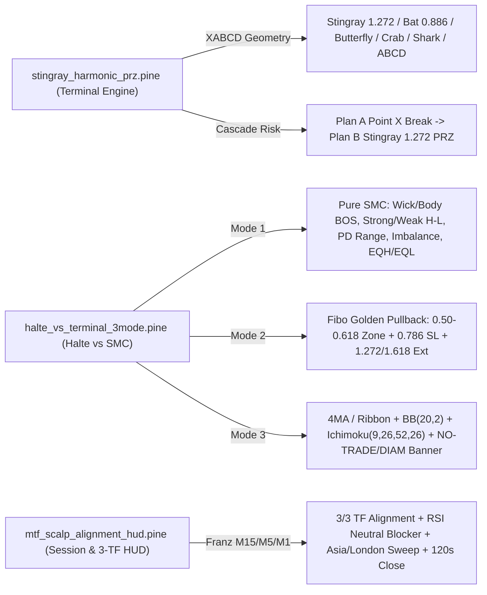

# Stingray Pine Script Suite (Halte vs Terminal)

TradingView Pine Script v6 indicator suite implementing **Arist MD (Mancing Dollar)** & Co-Mentor technical architectures across three operational chart engines plus webhook alert templates.

> **Disclaimer:** Educational & quantitative research tooling only. Not financial advice. Always enforce strict risk management (`System SL`, max `1%–2%` risk/trade, and compartmented capital).

---

## Architecture: The 3 Chart Engines



---

## Included Indicators

| File | Attribution | Key Features |
|---|---|---|
| [`indicators/stingray_harmonic_prz.pine`](./indicators/stingray_harmonic_prz.pine) | Arist MD & Ragnaray | Proprietary **Stingray** (`B: 0.382–0.50`, `D: 1.272 XA`), Bat (`0.886`), Butterfly (`B=0.786, D=1.272`), Crab (`1.618`), Shark (`0.886–1.13 XC`), ABCD; **Point B Trigger Dump/Pump**; **Plan A Bat -> Plan B Stingray Cascade**; Fibo C–D `0.382 / 0.50 / 0.618` TP & `50%` Zero-Risk BEP line. |
| [`indicators/halte_vs_terminal_3mode.pine`](./indicators/halte_vs_terminal_3mode.pine) | Arist MD | Switchable **3-Mode Engine**: Pure SMC (`Body Close` vs `Wick Break` BOS, >=2 counter-candle swings, Strong vs Weak H/L, `MSS / TC / SB`, `PD Range 0/0.5/1`, unmitigated FVG/Imbalance, EQH/EQL); Fibo Golden Zone (`0.50–0.618` + `0.786` SL); Indicator Halte (`4MA 25/50/100/200` or `5/50/100/200`, `BB 20,2`, `Ichimoku 9,26,52,26` with automatic `NO-TRADE / DIAM` Kumo/tangle regime banner). |
| [`indicators/mtf_scalp_alignment_hud.pine`](./indicators/mtf_scalp_alignment_hud.pine) | Franz & Arist MD | Non-repainting M15/M5/M1 trend alignment HUD, `RSI(14)` neutral zone (`45–55`) filter, WIB (`UTC+7`) **Asia Range (06:00–14:00)** box + **London Sweep (15:00)** detector, and **Last 120s** candle-close timer. |
| [`webhooks/tradingview_alert_templates.json`](./webhooks/tradingview_alert_templates.json) | Suite | Structured JSON webhook alert templates mapped 1-to-1 to indicator `alertcondition()` hooks. |

---

## Installation on TradingView

1. Open [TradingView](https://www.tradingview.com/) and launch **Pine Editor**.
2. Open any `.pine` file inside `indicators/`, copy the full source (`//@version=6`), paste into Pine Editor, and click **Add to chart**.
3. Configure your preferred mode inputs:
   - Never run Mode 1 Pure SMC and Mode 3 Indicator Halte rules simultaneously on conflicting setups — pick **one** mode and validate across at least 200 backtests.
   - Keep `lookahead=barmerge.lookahead_off` unchanged in `mtf_scalp_alignment_hud.pine` to prevent MTF repainting.

---

## Validation & CI

Run local static verification and unit tests:

```bash
python3 tools/validate_pinescript.py
pytest tests -v
```
